# KahootP46 Live

**Real-time quiz answer viewer.** Ingresas el PIN de 6 dígitos de una partida de **QuizLive** (el motor de quizzes propio del proyecto) y ves al instante cada pregunta, sus opciones y la respuesta correcta en cuanto el servidor la revela, todo por WebSocket.


**Demo:** pendiente de publicar (la guía está en [docs/despliegue.md](docs/despliegue.md)) · **Usuario de prueba:** el panel de admin usa la cuenta de `ADMIN_EMAIL`; el visor es anónimo y solo necesita el PIN.

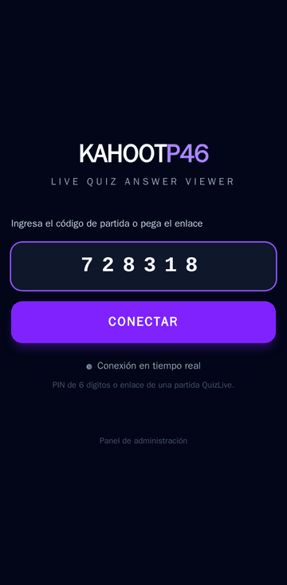

| Ingreso del PIN | Pregunta en vivo | Respuesta revelada |
|---|---|---|
| 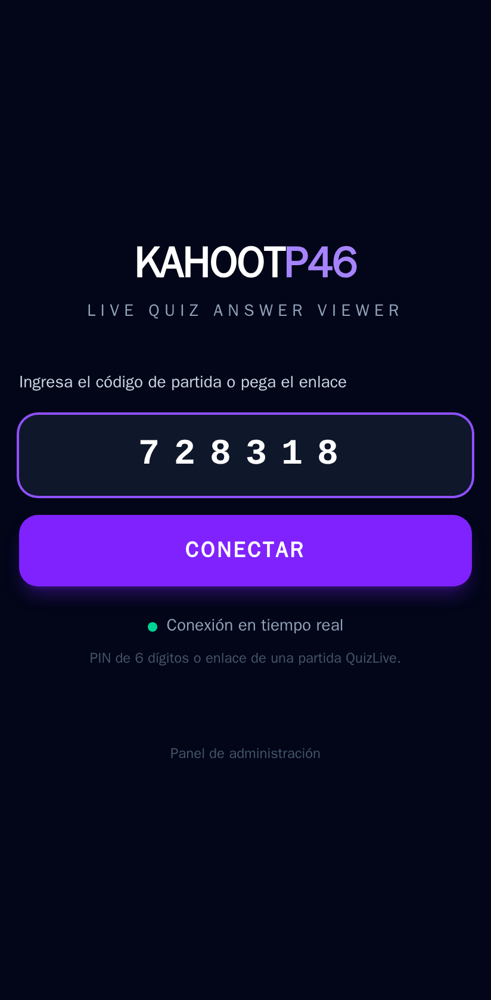 | 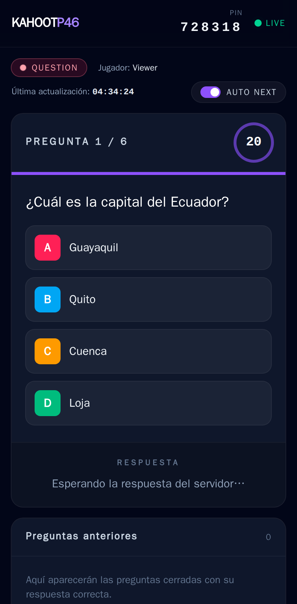 | 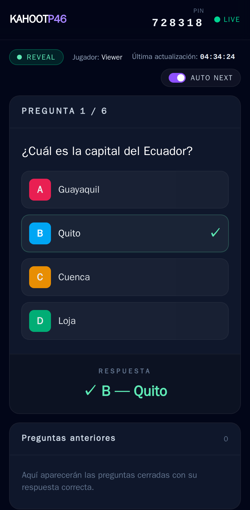 |

**Visor en escritorio** (pregunta abierta con historial, y respuesta revelada):

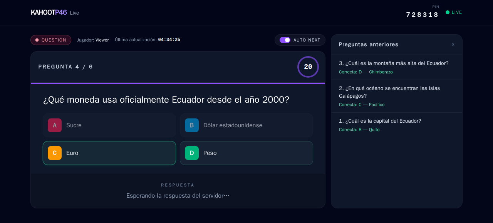
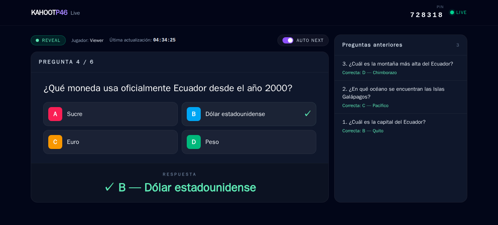

**Panel de administración** (quizzes, editor y control de la partida):

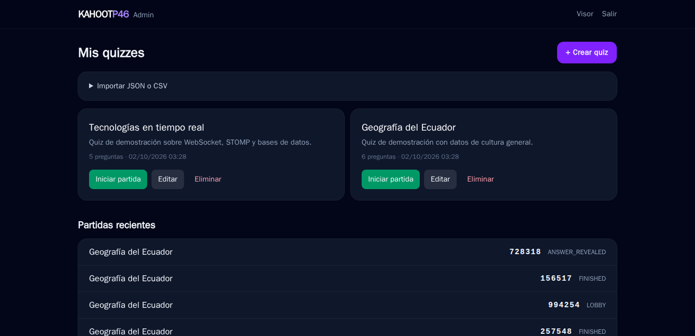
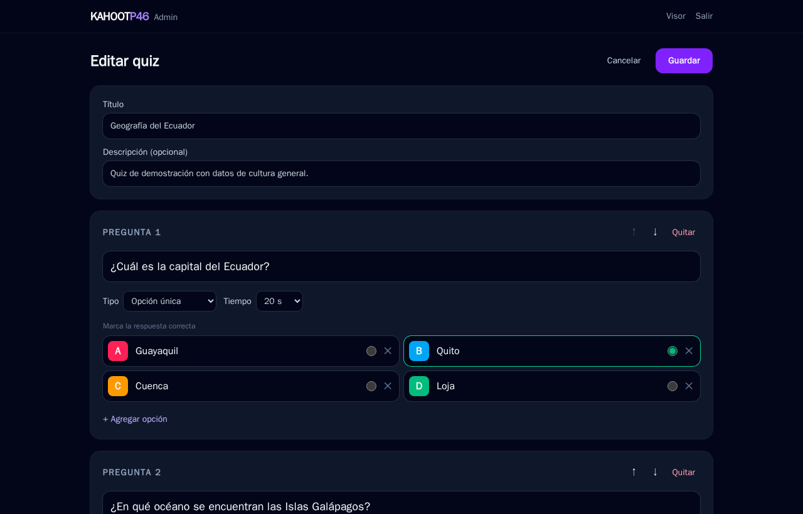
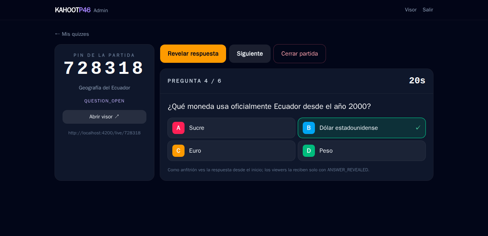

> Proyecto de portafolio sin afiliación con Kahoot! ASA. Funciona **solo** con partidas del motor propio QuizLive y no se conecta a servicios de terceros. Ver [Proveedores](docs/arquitectura.md#proveedores).

## Problema que resuelve

En una clase o en una presentación, el anfitrión proyecta un quiz, pero quien está lejos de la pantalla o la sigue en remoto se pierde la pregunta, el tiempo o la respuesta. KahootP46 Live es una **segunda pantalla para el móvil**: con el PIN, cualquiera sigue la partida en vivo y repasa las preguntas anteriores. La respuesta correcta solo aparece cuando el servidor la revela, nunca antes.

## Funcionalidades

- **Visor en tiempo real** (`LiveAnswerViewerComponent`): número de pregunta (`PREGUNTA 4 / 20`), texto, opciones A–F, cronómetro sincronizado con el reloj del servidor y respuesta resaltada (`✓ B — Quito`).
- **Estados visibles:** `CONNECTED`, `WAITING`, `QUESTION`, `REVEAL`, `FINISHED`, `ERROR`, `RECONNECTING`, más el indicador `● LIVE` y la hora de la última actualización.
- **AUTO NEXT:** cada `QUESTION_STARTED` reemplaza la pantalla y cada `ANSWER_REVEALED` muestra la respuesta, sin tocar ningún botón.
- **Historial** "Preguntas anteriores", con la respuesta correcta de cada una y la opción de volver a consultarlas.
- **Reconexión automática** con backoff exponencial. Al volver se resincroniza con un snapshot sin perder la pregunta, el historial ni el estado (también resiste un F5).
- **Panel admin:** crear, editar y eliminar quizzes; agregar preguntas y opciones; marcar la correcta; definir el tiempo; importar JSON o CSV; iniciar, revelar, avanzar y cerrar partidas.
- **Revelado automático** cuando se acaba el tiempo, decidido por el servidor y seguro con varias instancias del backend.

## Arquitectura

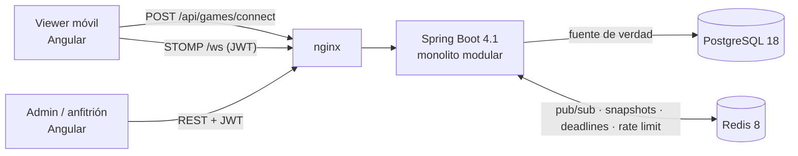

Monolito modular verificado con **Spring Modulith**: `auth`, `quiz`, `game`, `websocket` y `viewer`, más `shared`. Cada evento se confirma en PostgreSQL y, **después del commit**, se publica en Redis Pub/Sub. Desde ahí cada instancia lo reenvía a sus sesiones STOMP, así que se puede escalar horizontalmente. Detalle en [docs/arquitectura.md](docs/arquitectura.md).

## Stack y por qué

| Capa | Tecnología | Motivo |
|---|---|---|
| Backend | Java 21 + Spring Boot 4.1.1, Spring WebSocket/STOMP, Spring Security 7 (JWT HS256), Spring Modulith 2.1 | La línea 3.x de Boot terminó su soporte OSS el 2026-06-30. STOMP da destinos, heartbeats y suscripciones listos. Modulith hace cumplir los límites entre módulos |
| Datos | PostgreSQL 18 + Flyway | Integridad (FK, CHECK, índices únicos parciales para el PIN activo y la respuesta única), migraciones versionadas |
| Tiempo real entre instancias | Redis 8 (Pub/Sub, ZSET, contadores) | Bus de eventos, snapshot compartido, deadlines distribuidos y rate limiting. Todo efímero y reconstruible |
| Frontend | Angular 22 (signals, zoneless) + Tailwind CSS 4 + @stomp/rx-stomp | UI reactiva sin Zone.js, diseño oscuro mobile-first y reconexión STOMP con backoff |
| DevOps | Docker multi-stage (usuario no root), docker compose, GitHub Actions, gitleaks, Dependabot | Un comando para levantar todo; CI con tests reales en contenedores |

## Modelo de datos

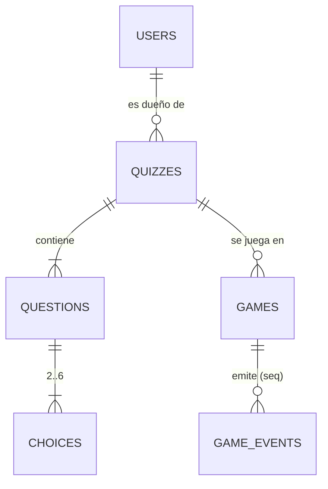

Tablas, restricciones y reglas en [docs/modelo-datos.md](docs/modelo-datos.md). Las fuentes están en [docs/investigacion.md](docs/investigacion.md).

## Cómo ejecutar en local

### Con Docker (recomendado)

```bash
cp .env.example .env      # completa DB_PASSWORD, REDIS_PASSWORD, JWT_SECRET, ADMIN_PASSWORD
docker compose up --build
```

- Visor: http://localhost:4200
- Admin: http://localhost:4200/admin (credenciales `ADMIN_EMAIL` / `ADMIN_PASSWORD` de tu `.env`)
- Swagger: http://localhost:8081/swagger-ui.html

Con el perfil `demo` se cargan dos quizzes ficticios ("Geografía del Ecuador" y "Tecnologías en tiempo real").

### Sin Docker

Requisitos: JDK 21, Node 24 LTS, y PostgreSQL 18 y Redis 8 corriendo.

```bash
# backend (exporta antes las variables de .env.example con valores reales)
cd backend && ./mvnw spring-boot:run -Dspring-boot.run.profiles=demo
# frontend (proxy de /api y /ws a :8080)
cd frontend && npm ci && npm start
```

## Cómo se usa

1. **Crear un quiz:** en Admin, *Crear quiz* (preguntas, opciones, correcta, tiempo) o *Importar JSON/CSV* ([formatos](docs/protocolo-websocket.md#importación-de-quizzes)).
2. **Iniciar una partida:** *Iniciar partida* genera un **PIN de 6 dígitos**. En la vista del anfitrión están *Iniciar*, *Revelar*, *Siguiente* y *Cerrar partida*.
3. **Conectarse con el PIN o el enlace:** en el móvil, abrir la app, escribir el PIN de 6 dígitos o pegar el enlace de la partida (`…/live/123456`) y pulsar **CONECTAR**. Los PIN o enlaces de otros servicios (por ejemplo Kahoot!) se rechazan con una explicación.
4. **El visor:** muestra cada pregunta en cuanto empieza. Al acabarse el tiempo, o si el anfitrión revela antes, aparece la respuesta correcta, y la siguiente pregunta entra sola.

## Variables de entorno

| Variable | Descripción | Obligatoria |
|---|---|---|
| `DB_NAME` / `DB_USER` | Base y usuario de PostgreSQL | Sí (`DB_NAME` tiene valor por defecto) |
| `DB_PASSWORD` | Contraseña de PostgreSQL | Sí |
| `REDIS_PASSWORD` | Contraseña de Redis (solo letras y números) | Sí |
| `JWT_SECRET` | Secreto HS256, mínimo 32 bytes aleatorios (la app no arranca si es más corto) | Sí |
| `ADMIN_EMAIL` / `ADMIN_PASSWORD` | Cuenta admin creada al primer arranque (contraseña de 12 a 72 caracteres) | Sí |
| `CORS_ALLOWED_ORIGINS` | Orígenes permitidos para la API y el WebSocket, separados por coma | Sí |
| `SPRING_PROFILES_ACTIVE` | `demo` carga los quizzes de ejemplo | No |
| `FRONTEND_PORT` / `BACKEND_PORT` | Puertos en el host (4200 / 8081) | No |

> Si tu sistema ya define una variable con el mismo nombre (por ejemplo `DB_PASSWORD`), `docker compose` usa la del sistema en lugar de la del `.env`.

## API y WebSocket

| Método | Ruta | Descripción |
|---|---|---|
| POST | `/api/games/connect` | PIN → token de viewer + snapshot |
| GET | `/api/games/{pin}` | Snapshot completo |
| GET | `/api/games/{pin}/current` | Pregunta actual y, si ya se reveló, su respuesta |
| GET | `/api/games/{pin}/questions` | Preguntas mostradas hasta ahora |
| GET | `/api/games/{pin}/history` | Preguntas cerradas con su respuesta |
| POST | `/api/host/games` · `/{id}/start` · `/reveal` · `/next` · `/finish` | Control de la partida (admin) |
| CRUD | `/api/quizzes` · `POST /api/quizzes/import` | Quizzes propios (admin) |

**WebSocket (STOMP):** `CONNECT /ws` con `Authorization: Bearer <viewerToken>`, después `SUBSCRIBE /topic/games/{pin}` (eventos) y `/app/games/{pin}/state` (snapshot). Los eventos son `GAME_CONNECTED`, `GAME_STARTED`, `QUESTION_STARTED`, `ANSWER_REVEALED`, `QUESTION_FINISHED`, `GAME_FINISHED` y `GAME_ERROR`. El formato completo, con ejemplos JSON, está en [docs/protocolo-websocket.md](docs/protocolo-websocket.md). Hay ejemplos REST en [docs/http/kahootp46.http](docs/http/kahootp46.http) y la referencia completa en Swagger.

## Tests y cobertura

```bash
cd backend && ./mvnw verify        # 52 tests: unitarios + integración (Testcontainers) + Modulith + JaCoCo ≥ 70 %
cd frontend && npm test            # Vitest: reducer del visor y lectura del PIN o del enlace
# e2e (Playwright, escritorio y móvil) contra el stack levantado con docker compose:
cd e2e && npm ci && npx playwright install chromium && set -a && . ../.env && set +a && npm test
```

- **Backend:** `LiveAnswerViewerIntegrationTest` (crear partida → PIN → viewer STOMP → `QUESTION_STARTED` → `ANSWER_REVEALED` → siguiente pregunta → `GAME_FINISHED`), PIN inválido o inexistente, reveal por tiempo, reconexión, **100 viewers simultáneos**, seguridad STOMP y hosting del SPA. Cobertura actual: 91 % de instrucciones.
- **e2e:** el viewer sigue una partida completa y consulta el historial, el servidor revela al agotarse el tiempo, **reconexión con el WebSocket cortado** (recupera lo que pasó sin conexión), recarga sin perder estado, PIN o enlace, y el admin crea un quiz, inicia la partida y un viewer recibe la respuesta. Corren en CI sobre `docker compose`.
- **Carga:** [`loadtest/viewers.js`](loadtest/viewers.js) (k6) abre N viewers STOMP reales sobre un WebSocket y mide el tiempo entre que el servidor crea cada evento y el cliente lo recibe.

  ```bash
  docker run --rm --network kahootp46-live_default -e BASE_URL=http://frontend:8080     -e ADMIN_EMAIL -e ADMIN_PASSWORD -e VIEWERS=300     -v "$PWD/loadtest:/scripts:ro" grafana/k6:2.3.0 run /scripts/viewers.js
  ```

  Resultado medido el 2026-10-01 con `docker compose` en un PC de escritorio: **300 viewers simultáneos, 300 recibieron `QUESTION_STARTED` y `ANSWER_REVEALED`, 0 errores de socket y latencia del evento p95 = 97 ms (máximo 102 ms)**. La misma prueba contra la imagen única de despliegue con 50 viewers dio p95 = 97 ms. Son números de una máquina local, no de Render: allí el plan gratuito tiene 0,1 CPU.
- El mapa requisito → test está en [docs/arquitectura.md](docs/arquitectura.md#plan-de-pruebas).

## Despliegue (gratis)

Listo para publicar, sin tarjeta, en un solo servicio: la imagen del [`Dockerfile`](Dockerfile) de la raíz incluye el backend y el build de Angular (mismo origen, sin CORS). El [`render.yaml`](render.yaml) describe el servicio web y el Key Value. Los pasos y los límites verificados están en [docs/despliegue.md](docs/despliegue.md).

| Pieza | Servicio | Límite del plan gratuito |
|---|---|---|
| Backend + frontend | Render web service (Docker) | 512 MB, 0,1 CPU, se duerme a los 15 min sin tráfico; WebSocket soportado |
| Redis | Render Key Value | 25 MB, sin persistencia (todo es reconstruible) |
| PostgreSQL | Neon (conexión directa, `sslmode=require`) | 0,5 GB |

## Seguridad aplicada

- Secretos solo por variables de entorno; si falta uno, compose y Spring no arrancan. gitleaks en CI.
- Deny-by-default: rutas públicas explícitas y todo lo demás autenticado. JWT HS256 con una clave de 256 bits o más (RFC 7518) y expiración corta (admin 1 h, viewer 4 h).
- **El token de viewer está ligado a un PIN** (OWASP API1): con el PIN A no se pueden leer ni suscribir datos del PIN B.
- **La respuesta nunca viaja con la pregunta abierta** (OWASP API3); solo sale en `ANSWER_REVEALED`.
- **Rate limiting compartido en Redis**: connect 30/min y login 5/min por IP, contra la enumeración de PINs y la fuerza bruta (API4/API6).
- WebSocket: `Origin` en lista blanca (CSWSH), autenticación en `CONNECT`, autorización en cada `SUBSCRIBE`, `SEND` prohibido, frames de 8 KB como máximo y heartbeats.
- BCrypt, Bean Validation en los DTO, ProblemDetail sin stack traces, Actuator con solo `health`, CSP y headers de seguridad en nginx y Spring.
- Subida de archivos: solo `.json`/`.csv`, 256 KB como máximo, UTF-8 validado, el nombre de archivo no se guarda.
- Docker: imágenes con versión fija, multi-stage, usuario no root, healthchecks, puertos ligados a `127.0.0.1`.
- LOPDP: viewers anónimos; el único dato personal es el correo del admin.

## Decisiones técnicas

- **Spring Boot 4.1 en vez de 3.x** → la 3.5 terminó su soporte OSS el 2026-06-30; se mantiene Java 21 LTS.
- **Redis Pub/Sub + simple broker** en vez de un broker STOMP externo → Redis no habla STOMP y RabbitMQ sería otro servicio que mantener. Pub/Sub es *at-most-once*, por eso existen el `seq` y el snapshot al reconectar.
- **Eventos publicados AFTER_COMMIT** → un viewer nunca ve un evento cuya transacción se revirtió.
- **Deadlines en un ZSET de Redis con `ZREM` como claim**, y **bloqueo de fila** en cada comando → un único reveal por pregunta aunque haya N instancias, y sin sondear PostgreSQL (importante con el cómputo limitado del plan gratuito de Neon).
- **Snapshot por PIN en Redis** con escritura incondicional después del commit y `SETNX` para los lectores → no hay carreras que dejen una versión vieja en caché.
- **Sin `sendAnswer()`** → visor de solo lectura y menos superficie de ataque. Las tablas `players` y `answers` se eliminaron por quedar sin uso.
- **Proveedor externo como puerto, sin clase de Kahoot!** → su API oficial solo ofrece reportes post-partida y su política de uso prohíbe otros medios; una clase vacía sería código muerto.

## Roadmap

- [x] Pruebas e2e con Playwright, prueba de carga con k6, capturas y GIF.
- [x] Imagen única y `render.yaml` listos para desplegar.
- [ ] Publicar la demo en Render + Neon y poner su URL en este README.
- [ ] Importar un quiz desde el reporte Excel que exporta Kahoot! (necesita un archivo de muestra para respetar su estructura real).
- [ ] Versionado de quizzes (que el historial de partidas terminadas no cambie si se edita el quiz).
- [ ] Avance automático configurable tras el reveal.
- [ ] Adaptador para un proveedor externo **solo si** ofrece una API oficial en vivo y credenciales autorizadas.

## Fuentes de datos y licencias

- Quizzes de ejemplo: contenido propio de cultura general (sin datos personales), en `backend/src/main/resources/demo/`.
- Dependencias: Spring (Apache-2.0), Angular (MIT), Tailwind CSS (MIT), @stomp/stompjs y rx-stomp (Apache-2.0), PostgreSQL (PostgreSQL License), Redis 8 (RSALv2/SSPLv1/AGPLv3, usado sin modificar como servicio interno).
- Fuentes técnicas y normativas consultadas: [docs/investigacion.md](docs/investigacion.md).

## Autor

**Diego Francisco Granda Zhingre** · [GitHub](https://github.com/DiegoFranciscoG)
