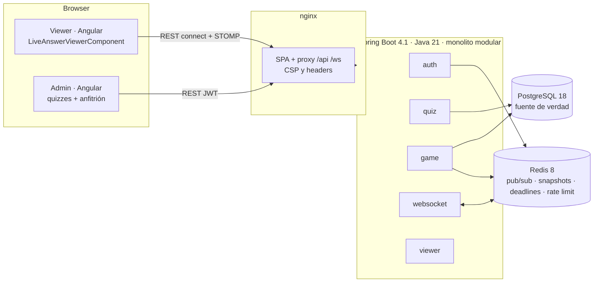

# Arquitectura

## Vista general



### Varias instancias del backend

El *simple broker* de STOMP vive en memoria, uno por instancia. Para que un viewer conectado a la instancia B reciba lo que el anfitrión hizo en la instancia A:

1. A confirma la transacción (estado en PostgreSQL + fila en `game_events`).
2. **Después del commit** (`@TransactionalEventListener(AFTER_COMMIT)`), A reescribe el snapshot en Redis y publica el evento en el canal `kp46:live-events`.
3. Todas las instancias, A incluida, reciben el evento y lo envían a sus sesiones STOMP de `/topic/games/{pin}` (`setPreservePublishOrder(true)` mantiene el orden).
4. Los timeouts de pregunta están en un *sorted set* de Redis. Cualquier instancia puede dispararlos, pero solo la que gana `ZREM` lo hace. Además, cada comando toma `SELECT … FOR UPDATE` sobre la partida, así que el anfitrión y el timeout nunca chocan.

## Módulos (Spring Modulith)

`ModularityTests` falla el build si un módulo usa paquetes internos de otro o si aparece un ciclo.

| Módulo | API pública (paquete raíz) | Internos | Depende de |
|---|---|---|---|
| `shared` (OPEN) | errores, `RateLimiter`, `CorsProperties`, `Clock` | — | — |
| `auth` | `TokenService`, `AccessGrant`, `AdminAccounts` | `config`, `controller`, `service`, `repository`, `domain`, `dto` | shared |
| `quiz` | `QuizCatalog`, `PlayableQuiz`, `QuizUsageGuard` (puerto), `QuestionType` | `controller`, `service`, `repository`, `domain`, `dto`, `mapper` | shared, auth (seed demo) |
| `game` | `LiveEvent` (protocolo), `GameViews`, `LiveGameQueries`, `GameStatus` | `controller`, `service`, `repository`, `domain`, `dto`, `scheduler` | quiz, shared |
| `websocket` | `LiveTopics` | `config` (STOMP + seguridad), `relay` (Redis ↔ STOMP) | game, auth, shared |
| `viewer` | — | `controller` (REST + `@SubscribeMapping`), `service`, `provider`, `dto` | game, auth, shared |

`quiz` no conoce a `game`: para bloquear la edición de un quiz que se está jugando define el puerto `QuizUsageGuard` y `game` lo implementa (inversión de dependencias).

## Estructura de carpetas

```
kahootp46-live/
├── backend/                       Spring Boot (Maven, Java 21)
│   ├── src/main/java/com/kahootp46/live/
│   │   ├── shared/                error (ProblemDetail), ratelimit, web
│   │   ├── auth/                  TokenService · config/SecurityConfig, JwtConfig · AdminBootstrap
│   │   ├── quiz/                  QuizCatalog · domain/Quiz, Question, Choice · service/QuizService, QuizImportService, QuizRules
│   │   ├── game/                  LiveEvent, GameViews · domain/Game · service/GameService, GameSnapshotService, PinGenerator · scheduler/
│   │   ├── websocket/             config/WebSocketConfig, StompAuthInterceptor · relay/LiveEventRelay, RedisLiveEventSubscriber
│   │   └── viewer/                provider/QuizProvider, QuizLiveProvider · controller/ViewerController, ViewerStompController
│   ├── src/main/resources/        application.yml · db/migration (Flyway) · demo/*.json
│   └── src/test/java/…            unit + integración (Testcontainers) + Modulith
├── frontend/                      Angular 22 + Tailwind 4 (nginx en producción)
│   └── src/app/
│       ├── core/                  models · api · auth · realtime/live-socket.ts
│       ├── features/live/         LiveAnswerViewerComponent · live-game.store · live-game.reducer (+ spec)
│       ├── features/home/         ingreso de PIN
│       ├── features/admin/        login · quiz-list · quiz-editor · host-game
│       └── shared/                status-badge · brand-logo · choice-style
├── e2e/                           Playwright (escritorio + móvil) y generador de capturas del README
├── loadtest/                      k6: N viewers STOMP simultáneos
├── docs/                          investigación · modelo de datos · protocolo · arquitectura · despliegue · http/
├── docker-compose.yml             desarrollo local: nginx + backend + PostgreSQL + Redis
├── Dockerfile · render.yaml       imagen única (backend + Angular) y Blueprint de Render
└── .github/workflows/ci.yml
```

## Clases principales

| Clase | Responsabilidad |
|---|---|
| `Game` | Máquina de estados de la partida (start / reveal / advance / finish) y contador `seq` |
| `GameService` | Comandos del anfitrión y `revealOnTimeout`, con bloqueo de fila. Registra cada evento |
| `LiveEventRecorder` | Asigna `seq`, inserta en `game_events` y publica el evento en el proceso |
| `GameProjections` | Construye eventos y snapshots. La respuesta solo aparece en `ANSWER_REVEALED`, en el historial o para el anfitrión |
| `GameSnapshotService` | Snapshot en Redis (escritura incondicional después del commit; los lectores solo usan `SETNX`) |
| `QuestionDeadlineScheduler` / `QuestionDeadlineStore` | Timeouts distribuidos en un ZSET de Redis y recuperación al arrancar |
| `PinGenerator` | PIN de 6 dígitos con `SecureRandom`; no se repite entre partidas vivas ni durante 24 h |
| `StompAuthInterceptor` | Autentica `CONNECT` con el JWT, autoriza `SUBSCRIBE` por PIN y rechaza `SEND` |
| `LiveEventRelay` / `RedisLiveEventSubscriber` | Puente commit → Redis Pub/Sub → STOMP en cada instancia |
| `QuizProvider` / `QuizLiveProvider` | Puerto del visor y su implementación sobre el motor propio |
| `TokenService` | JWT HS256: admin (1 h) y viewer (4 h, ligado al PIN) |
| `QuizImportService` / `QuizRules` | JSON y CSV → `QuizRequest` → una sola validación |
| `LiveSocket` (TS) | rx-stomp, backoff exponencial, renovación del token y resync por snapshot |
| `live-game.reducer` (TS) | Transición pura `estado × evento → estado` (dedupe por `seq`, detección de huecos) |
| `LiveGameStore` (TS) | Señales Angular, persistencia en `sessionStorage`, cronómetro con offset del servidor |

## API REST

Swagger en `http://localhost:8081/swagger-ui.html` (puerto `BACKEND_PORT`). Hay ejemplos en [`docs/http/kahootp46.http`](http/kahootp46.http).

| Método | Ruta | Acceso | Descripción |
|---|---|---|---|
| POST | `/api/auth/login` | público, 5/min por IP | Login del admin → JWT 1 h |
| POST | `/api/games/connect` | público, 30/min por IP | PIN → `viewerToken` + snapshot |
| GET | `/api/games/{pin}` | viewer de ese PIN / admin | Snapshot completo |
| GET | `/api/games/{pin}/current` | viewer / admin | Pregunta actual + respuesta si ya se reveló (204 si no hay pregunta) |
| GET | `/api/games/{pin}/questions` | viewer / admin | Preguntas ya mostradas (nunca las futuras) |
| GET | `/api/games/{pin}/history` | viewer / admin | Preguntas cerradas con su respuesta |
| GET/POST | `/api/quizzes` | admin | Listar / crear |
| GET/PUT/DELETE | `/api/quizzes/{id}` | admin (dueño) | Ver / reemplazar / eliminar (409 si hay partida activa) |
| POST | `/api/quizzes/import` | admin | `multipart` .json o .csv |
| GET/POST | `/api/host/games` | admin | Partidas recientes / crear partida (genera el PIN) |
| GET | `/api/host/games/{id}` | admin (anfitrión) | Estado, con la respuesta visible para el anfitrión |
| POST | `/api/host/games/{id}/start` · `/reveal` · `/next` · `/finish` | admin (anfitrión) | Controlar la partida |
| GET | `/actuator/health` | público | Único endpoint de Actuator expuesto |

Los errores siguen RFC 9457 (`application/problem+json`) sin stack traces.

## Proveedores

```java
public interface QuizProvider {
    Optional<GameSnapshot> connect(String pin);
    Optional<LiveQuestion> getCurrentQuestion(String pin);
    Optional<RevealedAnswer> getAnswer(String pin);   // vacío hasta que el servidor la revela
    List<HistoryItem> getHistory(String pin);
}
```

- **`QuizLiveProvider`** (implementado): lee el motor propio.
- **Proveedor externo autorizado** (no implementado a propósito). Para agregarlo hace falta:
  1. Una API oficial del tercero que entregue datos **en vivo**, con credenciales propias por variables de entorno.
  2. Un adaptador que traduzca sus eventos al protocolo `LiveEvent` (capa anticorrupción) y los publique por el mismo `LiveEventRecorder`/relay.
  3. Selección del proveedor por configuración.
- **Kahoot!:** su API oficial es de **reportes post-partida**, solo para el plan más alto, y su política de uso aceptable prohíbe otros medios de acceso (inv. #24, #25). Por eso no hay `AuthorizedKahootProvider`: no podría cumplir el contrato en vivo de forma legítima y sería código muerto. No se implementa scraping, uso de tokens privados, bots ni evasión de controles.

## Plan de pruebas

| Requisito | Test |
|---|---|
| Conexión con PIN | `ViewerConnectIntegrationTest.connectWithValidPinReturnsTokenAndSnapshot` |
| PIN inválido | `ViewerConnectIntegrationTest.invalidPinFormatIsRejected` |
| Partida inexistente | `ViewerConnectIntegrationTest.unknownPinAnswersNotFound` |
| Pregunta actual / respuesta correcta | `LiveAnswerViewerIntegrationTest.restEndpointsExposeTheCurrentQuestionButNotItsAnswerUntilRevealed` |
| GAME_STARTED · QUESTION_STARTED · ANSWER_REVEALED · cambio de pregunta · GAME_FINISHED | `LiveAnswerViewerIntegrationTest.viewerFollowsTheWholeGameInRealTime` (STOMP real) |
| Reveal por tiempo | `QuestionTimeoutIntegrationTest` |
| Reconexión WebSocket | `ReconnectionIntegrationTest` (backend) + `live-game.reducer.spec.ts` (cliente) |
| Múltiples viewers / 100 simultáneos | `MultipleViewersIntegrationTest` |
| Seguridad STOMP | `StompSecurityIntegrationTest` (sin token, token falso, otro PIN, destino arbitrario) |
| Autorización por objeto / rate limit | `ViewerConnectIntegrationTest` (403 otro PIN, 429, 401) |
| CRUD, importación JSON/CSV, bloqueo en partida activa | `QuizApiIntegrationTest`, `QuizImportServiceTest`, `QuizRulesTest` |
| Máquina de estados, PIN, contrato JSON | `GameTest`, `PinGeneratorTest`, `LiveEventJsonTest` |
| Límites del monolito modular | `ModularityTests` |
| Hosting del SPA en un solo origen (imagen de despliegue) | `SpaHostingIntegrationTest` (rutas del cliente, 404 en APIs inexistentes, HEAD, caché, cabeceras) |
| Flujo completo en navegador (escritorio y móvil) | `e2e/tests/viewer.spec.ts`: partida completa, historial, reveal por tiempo, **reconexión con el WebSocket cortado**, recarga, PIN o enlace |
| Panel de administración de punta a punta | `e2e/tests/admin.spec.ts`: crear quiz, iniciar partida y ver la respuesta en un viewer, importar CSV, redirección sin sesión |
| 100+ viewers y latencia | `MultipleViewersIntegrationTest` (100) y `loadtest/viewers.js` (300, p95 de 97 ms) |

Backend: `./mvnw verify` (JUnit 5 + Testcontainers con PostgreSQL 18 y Redis 8, más JaCoCo con un mínimo de 70 % en `game`, `quiz` y `viewer`). Frontend: `npm test` (Vitest). e2e: `npm test` dentro de `e2e/` con el stack levantado.
