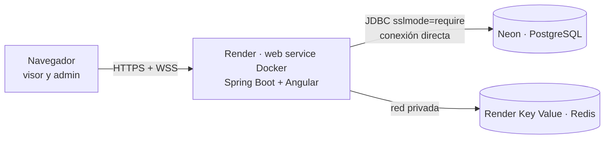

# Despliegue gratis (Render + Neon)

Un solo servicio web: la imagen del [`Dockerfile`](../Dockerfile) de la raíz empaqueta el backend **y** el build de Angular, así que el navegador habla con un único origen (sin CORS ni proxy aparte para el WebSocket). Para desarrollo local se sigue usando `docker-compose.yml` (nginx + backend por separado).



## Pasos

1. **Neon** (https://neon.com): crea un proyecto y una base `kahootp46`. Copia la conexión **directa**, la del host *sin* `-pooler`. Flyway necesita funciones de sesión que el pooler (PgBouncer en modo transacción) no soporta.
   - `DB_URL` = `jdbc:postgresql://<host>/<base>?sslmode=require`
   - `DB_USER` y `DB_PASSWORD` van aparte.
2. **Render** → *New* → *Blueprint* → elige este repositorio. Lee [`render.yaml`](../render.yaml) y crea el servicio web y el Key Value. Te pide `DB_URL`, `DB_USER`, `DB_PASSWORD`, `ADMIN_EMAIL` y `ADMIN_PASSWORD` (12 a 72 caracteres). `JWT_SECRET` lo genera Render y `REDIS_URL` sale del Key Value.
3. Espera el primer despliegue. Con 0,1 CPU, la compilación y el arranque de Spring tardan varios minutos.
4. Abre `https://<tu-servicio>.onrender.com`: el visor es la página de inicio y el panel está en `/admin`. Comprueba también `/actuator/health`.

`CORS_ALLOWED_ORIGINS` no hace falta en Render: por defecto toma `RENDER_EXTERNAL_URL` (la URL pública del servicio). Si usas un dominio propio, defínela con ese dominio, porque el `Origin` del WebSocket se valida contra esa lista.

Para empezar sin los quizzes de ejemplo, borra la variable `SPRING_PROFILES_ACTIVE` del servicio.

## Límites del plan gratuito (verificados el 2026-10-01)

| Servicio | Límite | Efecto en la app |
|---|---|---|
| Render web service | 512 MB de RAM, 0,1 CPU, 750 h/mes por workspace | La JVM usa SerialGC y `MaxRAMPercentage=70` para caber. El arranque es lento |
| Render web service | Se duerme tras 15 min sin tráfico entrante (HTTP **o** mensajes WebSocket) | El primer acceso tras dormir tarda en despertar. Una partida activa mantiene el servicio despierto |
| Render deploys | Cierran las conexiones WebSocket | Los viewers reconectan solos (backoff exponencial) y recuperan el estado con el snapshot |
| Render Key Value | 25 MB, 50 conexiones, **sin persistencia** | Solo guarda estado reconstruible (snapshots, deadlines, rate limit). Al arrancar, el backend vuelve a registrar los deadlines de las preguntas abiertas |
| Neon | 0,5 GB y 100 CU-h por proyecto | Sobra para quizzes y eventos; sin sondeo continuo a PostgreSQL |

Fuentes: [docs/investigacion.md](investigacion.md) (#21, #22 y los datos de Blueprint y Neon de esta guía).

## Cosas a verificar tras el primer despliegue

- **Rate limiting por IP:** el backend toma la IP real del header `X-Forwarded-For` solo si la petición llega desde un proxy interno (rangos privados). Si varias personas distintas reciben `429` al conectarse, el proxy de la plataforma no se está reconociendo como interno. En ese caso define `SERVER_TOMCAT_REMOTEIP_INTERNAL_PROXIES` con el rango del proxy. No uses `.*`: permitiría falsificar la IP.
- **WebSocket:** abre el visor, cambia a otra pestaña 20 minutos y vuelve. Debe aparecer `RECONNECTING` y luego `LIVE`.

## Probar la imagen única en local

```bash
docker build -t kahootp46-live .
docker compose up -d postgres redis          # reutiliza la base y Redis del compose
docker run --rm -p 8082:8080 --network kahootp46-live_default --env-file .env \
  -e DB_URL=jdbc:postgresql://postgres:5432/kahootp46 \
  -e REDIS_URL="redis://:${REDIS_PASSWORD}@redis:6379" \
  -e CORS_ALLOWED_ORIGINS=http://localhost:8082 kahootp46-live
# → http://localhost:8082
```
