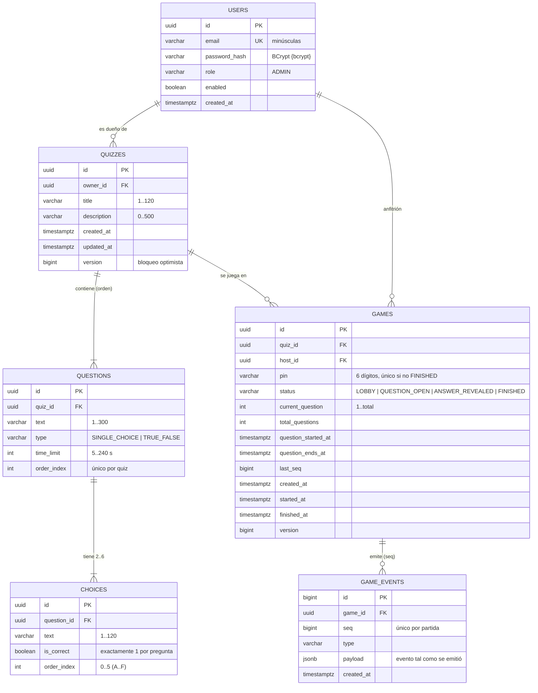

# Modelo de datos

PostgreSQL 18, versionado con Flyway ([`V1__create_schema.sql`](../backend/src/main/resources/db/migration/V1__create_schema.sql)).
Hibernate solo **valida** el esquema (`ddl-auto=validate`); nunca lo modifica.

## Tablas y reglas

| Tabla | Campo | Tipo | Restricción | Regla / fuente |
|---|---|---|---|---|
| users | email | varchar(254) | `UNIQUE`, `CHECK email = lower(email)` | Una cuenta por correo. Solo existe el admin creado desde `ADMIN_EMAIL` (no hay registro público) |
| users | password_hash | varchar(100) | NOT NULL | BCrypt con prefijo `{bcrypt}` (DelegatingPasswordEncoder). Nunca texto plano |
| quizzes | owner_id | uuid | FK `users` `ON DELETE CASCADE` | Cada admin ve y edita solo sus quizzes; un id ajeno responde 404 (OWASP API1, inv. #7) |
| quizzes | title | varchar(120) | `CHECK length(trim(title)) > 0` | Bean Validation `@NotBlank @Size(max=120)` |
| questions | (quiz_id, order_index) | — | `UNIQUE` | Orden estable; `PREGUNTA n` = `order_index + 1` |
| questions | time_limit | int | `CHECK 5..240` | La app solo acepta los presets {5, 10, 20, 30, 60, 90, 120, 240} |
| questions | type | varchar(20) | `CHECK IN (...)` | `TRUE_FALSE` exige exactamente 2 opciones |
| choices | (question_id, order_index) | — | `UNIQUE`, `CHECK 0..5` | De 2 a 6 opciones (letras A..F) |
| choices | is_correct | boolean | índice único parcial `WHERE is_correct` | Como máximo 1 correcta en la BD; el servicio exige exactamente 1 |
| games | pin | varchar(6) | `CHECK ~ '^[0-9]{6}$'`, índice único parcial `WHERE status <> 'FINISHED'` | Un PIN identifica a una sola partida viva. El generador además evita reusar un PIN durante 24 h |
| games | status, current_question | — | `CHECK` de estados y de rango | Máquina de estados en `Game` (unit tests en `GameTest`) |
| games | question_ends_at | timestamptz | — | Momento en que el servidor revela la respuesta (TIME_UP) |
| games | last_seq | bigint | NOT NULL | Contador de eventos de la partida; se persiste en la misma transacción que el evento |
| game_events | (game_id, seq) | — | `UNIQUE` | Registro *append-only* de todo lo que se emitió a los viewers (auditoría y orden) |

## Qué vive en Redis (efímero, reconstruible)

| Clave | Tipo | TTL | Para qué |
|---|---|---|---|
| `kp46:snapshot:{pin}` | string (JSON) | 10 min | Snapshot que reciben los viewers al conectar o reconectar; se reescribe después de cada evento confirmado |
| `kp46:deadlines` | sorted set | — | Fin de cada pregunta abierta (score = epoch ms). Lo vigila cualquier instancia y `ZREM == 1` es el *claim* |
| `kp46:rl:{login\|connect}:{ip}` | string (contador) | 1 min | Rate limiting de ventana fija compartido entre instancias |
| canal `kp46:live-events` | Pub/Sub | — | Reenvía cada evento a todas las instancias del backend |

## Datos personales (LOPDP)

- Los viewers son **anónimos**: no hay tabla de jugadores ni de respuestas (se eliminó `sendAnswer()`), ni nicknames, ni IP persistida.
- El único dato personal es el correo del admin. Los seeds son quizzes de cultura general ficticios (`backend/src/main/resources/demo/*.json`).

## Cambios respecto al pedido original

- **`players` y `answers` eliminadas**: sin `sendAnswer()` no tenían uso y habrían sido código muerto.
- La "respuesta" vive en `choices.is_correct` y solo sale del servidor en `ANSWER_REVEALED`, en el historial o en la vista del anfitrión.
