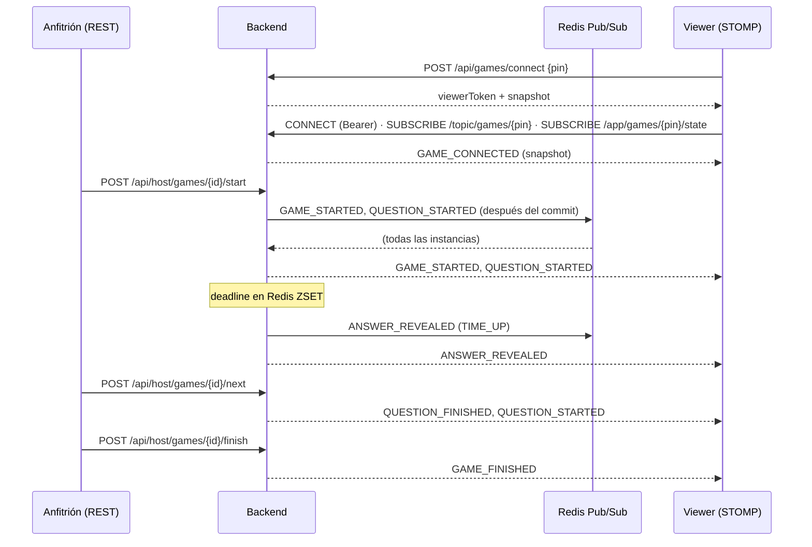

# Protocolo KahootP46 Live v1

Protocolo propio sobre **STOMP 1.2 / WebSocket**, solo en sentido **servidor → cliente**. El viewer no puede enviar nada: cualquier frame `SEND` se rechaza con `ERROR` y se cierra la conexión.

## Conexión

1. `POST /api/games/connect` con `{"pin": "582941"}` → `viewerToken` (JWT HS256, 4 h, ligado a ese PIN) + snapshot inicial. Tiene rate limiting por IP (30/min).
2. WebSocket a `ws(s)://<host>/ws` con un frame `CONNECT` que lleva el header `Authorization: Bearer <viewerToken>`. Heart-beat: 10 s / 10 s.
3. `SUBSCRIBE /topic/games/{pin}`: aquí llegan los eventos en vivo.
4. `SUBSCRIBE /app/games/{pin}/state`: responde **una vez**, solo a quien se suscribe, con `GAME_CONNECTED` y el snapshot completo.

Un token de viewer solo puede suscribirse a destinos de **su** PIN. Un token de admin puede suscribirse a cualquiera.

## Sobre (campos comunes)

```json
{
  "type": "QUESTION_STARTED",
  "protocolVersion": 1,
  "gameId": "0b6f7d0e-0f7a-4c55-9a52-3c8f1d0f2a10",
  "pin": "582941",
  "seq": 7,
  "sentAt": "2026-10-01T22:30:14.120Z"
}
```

- `seq`: contador por partida que sube de 1 en 1 con cada evento difundido. Sirve para descartar duplicados (`seq <= lastSeq`) y para detectar huecos (`seq > lastSeq + 1`), en cuyo caso el cliente vuelve a pedir el snapshot.
- Las fechas están en ISO-8601 UTC. El cronómetro se calcula con `endsAt` corregido por la diferencia entre el reloj del cliente y `serverTime`.

## Eventos

| Evento | Cuándo | Campos propios |
|---|---|---|
| `GAME_CONNECTED` | Al suscribirse a `/app/games/{pin}/state` (conexión inicial y cada reconexión) | `snapshot` |
| `GAME_STARTED` | El anfitrión inicia la partida | `quizTitle`, `totalQuestions` |
| `QUESTION_STARTED` | Se abre una pregunta | `questionNumber`, `totalQuestions`, `question`, `choices[{index,text}]`, `timeLimitSeconds`, `startedAt`, `endsAt` |
| `ANSWER_REVEALED` | Se acaba el tiempo (`reason: TIME_UP`) o el anfitrión revela (`HOST`) | `questionNumber`, `correctIndex`, `correctText`, `reason` |
| `QUESTION_FINISHED` | El anfitrión pasa a la siguiente pregunta; la actual queda cerrada en el historial | `questionNumber` |
| `GAME_FINISHED` | Termina la última pregunta o el anfitrión cierra la partida | `questionsPlayed`, `totalQuestions`, `reason: COMPLETED \| CLOSED_BY_HOST` |
| `GAME_ERROR` | Solo para ese viewer (p. ej. el PIN ya no existe) | `code`, `message` |

> **Regla de seguridad del protocolo:** `QUESTION_STARTED` **nunca** incluye la respuesta. Solo el servidor sabe cuál es la opción correcta y la publica en `ANSWER_REVEALED` (lo verifican `LiveEventJsonTest` y `LiveAnswerViewerIntegrationTest`).

### Ejemplos

```json
{
  "type": "QUESTION_STARTED", "protocolVersion": 1, "gameId": "…", "pin": "582941", "seq": 2,
  "sentAt": "2026-10-01T22:30:14Z",
  "questionNumber": 4, "totalQuestions": 20,
  "question": "¿Cuál es la capital del Ecuador?",
  "choices": [
    { "index": 0, "text": "Guayaquil" }, { "index": 1, "text": "Quito" },
    { "index": 2, "text": "Cuenca" },    { "index": 3, "text": "Loja" }
  ],
  "timeLimitSeconds": 20, "startedAt": "2026-10-01T22:30:14Z", "endsAt": "2026-10-01T22:30:34Z"
}
```

```json
{
  "type": "ANSWER_REVEALED", "protocolVersion": 1, "gameId": "…", "pin": "582941", "seq": 3,
  "sentAt": "2026-10-01T22:30:34Z",
  "questionNumber": 4, "correctIndex": 1, "correctText": "Quito", "reason": "TIME_UP"
}
```

### Snapshot (`GAME_CONNECTED.snapshot` y `GET /api/games/{pin}`)

```json
{
  "gameId": "…", "pin": "582941", "status": "ANSWER_REVEALED",
  "quizTitle": "Geografía del Ecuador", "totalQuestions": 6,
  "currentQuestion": { "questionNumber": 2, "totalQuestions": 6, "question": "…", "choices": [], "timeLimitSeconds": 20, "startedAt": "…", "endsAt": "…" },
  "currentAnswer": { "questionNumber": 2, "correctIndex": 2, "correctText": "Pacífico" },
  "history": [ { "questionNumber": 1, "question": "…", "choices": [], "correctIndex": 1, "correctText": "Quito" } ],
  "lastSeq": 6,
  "serverTime": "2026-10-01T22:31:16Z"
}
```

`currentAnswer` es `null` mientras la pregunta está abierta.

## Secuencia de una partida



## Reconexión (cliente)

1. Si se cae el WebSocket, el estado pasa a `RECONNECTING` y la pantalla conserva la pregunta, la respuesta y el historial (también en `sessionStorage`, así que sobreviven a un F5).
2. `@stomp/rx-stomp` reintenta con backoff exponencial de 1 s a 15 s. Antes de cada intento renueva el token si le queda menos de 1 min.
3. Al reconectar vuelve a suscribirse a `/topic` y a `/app/.../state`, y el servidor responde con `GAME_CONNECTED`. El cliente aplica el snapshot solo si `lastSeq` es mayor o igual al suyo, así que nunca retrocede.
4. Los eventos con `seq <= lastSeq` se ignoran. Si llega un hueco de `seq`, se pide el snapshot otra vez.

## Errores de transporte

- `CONNECT` sin token, con token inválido o vencido → frame `ERROR` y cierre.
- `SUBSCRIBE` a otro PIN o a un destino no permitido → `ERROR` y cierre.
- `SEND` a cualquier destino → `ERROR` y cierre (protocolo de solo lectura).
- Los frames entrantes tienen un límite de 8 KB.

## Importación de quizzes

**JSON**

```json
{
  "title": "Historia del Ecuador",
  "description": "opcional",
  "questions": [
    {
      "question": "¿Cuál es la capital del Ecuador?",
      "type": "SINGLE_CHOICE",
      "timeLimit": 20,
      "choices": [
        { "text": "Guayaquil", "correct": false },
        { "text": "Quito", "correct": true }
      ]
    }
  ]
}
```

`type` (por defecto `SINGLE_CHOICE`) y `timeLimit` (por defecto 20) son opcionales.

**CSV** (RFC 4180, UTF-8; el título va en el campo `title` del formulario)

```csv
question,choice_a,choice_b,choice_c,choice_d,correct,time_limit
¿Cuál es la capital del Ecuador?,Guayaquil,Quito,Cuenca,Loja,B,20
"Pregunta con coma, entre comillas",Sí,No,,,A,
```

`choice_c` a `choice_f` y `time_limit` son opcionales; `correct` es la letra A–F. Máximo 256 KB y solo `.json` o `.csv`. Las dos rutas pasan por la misma validación que el formulario.
